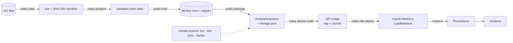

# Heart-Disease Risk API: an end-to-end MLOps pipeline

BITS Pilani WILP · Machine Learning Operations (AIMLCZG523) · Assignment 1
Author: Rajesh Patel (BITS ID: _to fill_)

A classifier that predicts the presence of heart disease from routine clinical measurements
(UCI Heart Disease dataset), trained with tracked experiments, tested and built in CI, and served
as a containerised, monitored API on Kubernetes.

**Design principle: traceability.** Every prediction the API returns can be traced to the model
version, the training run, the code commit and the exact bytes of the data it was trained on, the
way GxP-regulated clinical systems demand an audit trail.

> **Educational project. Not a medical device and not medical advice.**

## Status

| # | Task | Marks | Status |
|---|---|---|---|
| 0 | Environment (WSL2 + Docker Desktop; lab VM alternative) + repo skeleton | – | ✅ |
| 1 | Data acquisition, cleaning, EDA | 5 | ✅ |
| 2 | Feature engineering + model development | 8 | ✅ |
| 3 | Experiment tracking (MLflow) | 5 | ✅ |
| 4 | Model packaging + reproducibility | 7 | ✅ |
| 5 | CI/CD pipeline + automated tests | 8 | 🟡 workflow written and validated (actionlint); first run on first push |
| 6 | Containerised serving API | 5 | ✅ |
| 7 | Kubernetes deployment | 7 | ✅ LoadBalancer on localhost; Traefik Ingress overlay ready |
| 8 | Monitoring + logging | 3 | ✅ Prometheus + Grafana; input-drift alerts fire on shifted traffic |
| 9 | Report, screenshots, video | 2 | 🟡 report built (11 pages) with screenshot placeholders; screenshots and video pending |

## Architecture



Details, the traceability chain and component choices: [docs/architecture.md](docs/architecture.md).

## Results

Champion: **logistic regression** (L1, C = 1, balanced classes), chosen by decision D5: its mean
cross-validated ROC-AUC tied with random forest, and it had the higher recall.

| Model | CV ROC-AUC (5-fold) | CV recall | Hold-out ROC-AUC | Hungary | Switzerland | VA Long Beach |
|---|---|---|---|---|---|---|
| **Logistic regression** | **0.909 ± 0.011** | **0.819** | 0.950 | **0.895** | 0.741 | 0.698 |
| Random forest | 0.904 ± 0.025 | 0.774 | 0.948 | 0.895 | 0.771 | 0.726 |
| Gradient boosting (HGB) | 0.890 ± 0.020 | 0.792 | 0.951 | 0.841 | 0.739 | 0.705 |

Trained on Cleveland only (242 patients, 61 held out); the other three hospitals are external
validation. Performance drops at Switzerland and VA, whose patients are older, reach lower heart
rates and lack most `ca`/`thal` tests: see the [model card](docs/MODEL_CARD.md).

## Quick start

```bash
make help                                  # every target, one per pipeline stage
make all                                   # verify data -> validation gate -> train -> package
make docker-build docker-run smoke         # API in a container on http://localhost:8000
make k8s-deploy k8s-smoke                  # API on Kubernetes behind http://localhost
make monitoring-up traffic traffic-shift   # Prometheus :9090, Grafana :3000, drift demo
```

| Stage | Targets |
|---|---|
| Data | `data` · `verify-data` · `prepare` · `eda` |
| Model | `train` · `mlflow-ui` (http://localhost:5000) · `experiments-report` · `package` · `all` |
| Quality | `lint` · `format` · `test` · `lock` |
| Serving | `serve` · `docker-build` · `docker-run` · `smoke` · `docker-stop` |
| Kubernetes | `k8s-validate` · `k8s-deploy` · `k8s-status` · `k8s-smoke` · `k8s-logs` · `k8s-self-heal` · `k8s-down` |
| Monitoring | `monitoring-up` · `grafana` · `traffic` · `traffic-shift` · `monitoring-down` |

## Using the API

```bash
curl -s http://localhost/predict -H 'Content-Type: application/json' \
     -H 'X-Request-ID: demo-1' --data @samples/patient_high_risk.json
```

```json
{
  "prediction": 1,
  "label": "disease",
  "probability": 0.9926,
  "confidence": 0.9926,
  "risk_band": "high",
  "imputed_fields": [],
  "request_id": "demo-1",
  "model": {"name": "heart-disease-classifier", "version": 5, "run_id": "4360f322…", "family": "logistic_regression"}
}
```

| Endpoint | Purpose |
|---|---|
| `POST /predict` | One patient. Only `age`, `sex` and `cp` are required; any other field may be `null` and is then imputed and listed in `imputed_fields` |
| `POST /predict/batch` | Up to 100 patients, answers in request order |
| `GET /model-info` | The model's `lineage.json`: registry version, runs, commit, data hashes, metrics |
| `GET /health`, `GET /ready` | Liveness; readiness (503 until a model is loaded) |
| `GET /metrics` | Prometheus series |
| `GET /docs` | Interactive OpenAPI documentation |

Invalid input gets a 422 naming the field. Every response carries `X-Request-ID` and
`X-Model-Version`; every prediction writes one JSON audit line holding an input hash, never the
clinical values.

## Documentation

| Document | Content |
|---|---|
| [docs/report/report.pdf](docs/report/report.pdf) | The assignment report |
| [docs/architecture.md](docs/architecture.md) | Architecture, traceability chain, component choices |
| [docs/DECISIONS.md](docs/DECISIONS.md) | Decisions D0–D12: options, choice, reason |
| [docs/MODEL_CARD.md](docs/MODEL_CARD.md) | Intended use, performance per site, limitations |
| [docs/RUNBOOK.md](docs/RUNBOOK.md) | Deploy, release a new model, roll back, troubleshoot |
| [data/README.md](data/README.md) | Data provenance, licence, cleaning rules |
| [data/processed/DATA_CARD.md](data/processed/DATA_CARD.md) | Rows, missingness and checksums per site |
| [notebooks/01_eda.ipynb](notebooks/01_eda.ipynb) | Exploratory data analysis (HTML: `reports/eda.html`) |

## Repository layout

```
heart-disease-mlops/
├── Makefile                 one target per pipeline stage (`make help`)
├── requirements.in          direct dependencies (human-edited)
├── requirements.txt         fully pinned lock for Python 3.12 (`make lock`)
├── requirements-serve.*     API-only lock, constrained to the training versions
├── pyproject.toml           package metadata + ruff/pytest config
├── configs/data.yaml        data sources, plausibility ranges, validation-gate threshold
├── configs/train.yaml       seed, CV, model grids, selection rule, threshold (decisions D3-D6)
├── .github/workflows/ci.yml lint -> test -> train (quality gate) + docker build and smoke test
├── Dockerfile               multi-stage, non-root API image with the champion baked in
├── samples/                 example /predict and /predict/batch payloads (real UCI rows)
├── k8s/                     kustomize: base, release component, overlays local (LB) + ingress
├── monitoring/              Prometheus (discovery, rules, alerts) + Grafana (dashboard as code)
├── scripts/vm_bootstrap.sh  sets up WSL Ubuntu or the BITS lab VM
├── scripts/smoke.sh         end-to-end smoke test of a running API
├── scripts/traffic.py       normal / shifted traffic generator for the drift demonstration
├── scripts/build_report.py  docs/report/report.md -> HTML -> PDF (Chrome)
├── src/heartrisk/           data/, features, train, evaluate, tracking, package, api/ (FastAPI)
├── tests/                   pytest suite
├── notebooks/01_eda.ipynb   EDA notebook (executed by `make eda`)
├── data/README.md           provenance, licence, cleaning rules
├── data/raw/                UCI source files + MANIFEST.json (SHA-256 per file)
├── data/processed/          heart_clean.csv, rejected.csv, validation report, data card
├── reports/                 EDA + model figures, model comparison, external validation, metrics JSON
├── models/champion/         exported champion (MLflow format, skops) + lineage.json
├── docs/                    architecture, decisions, model card, runbook, video script, report
└── docs/screenshots/        evidence for the report
```

## Environment

| | Primary: local PC | Alternative: BITS lab VM |
|---|---|---|
| Shell | WSL2 Ubuntu 24.04 (Python 3.12) | Rocky Linux 9.5 (Python 3.12) |
| Containers | Docker Desktop (WSL integration on) | Docker Engine |
| Kubernetes | Docker Desktop's built-in cluster (kubeadm, single node) | minikube (docker driver) |
| Use | Day-to-day development, deployment, screenshots | Clean-machine reproducibility check |

The repository lives on the Windows drive and is used from Ubuntu through `/mnt/d/...`.
Commits are made from Windows; the Python virtual environment (`~/.venvs/heartrisk`) and the MLflow
store (`~/.heartrisk/mlflow`, SQLite) live on the Linux filesystem for speed and file locking.
`scripts/vm_bootstrap.sh` detects which environment it is in.

### Local PC: one-time setup

1. Docker Desktop → Settings → Resources → WSL integration → enable **Ubuntu-24.04** → Apply & restart.
2. Docker Desktop → Kubernetes → **Create cluster** → kubeadm (single node) → wait until it shows as running.
3. In Ubuntu:

```bash
cd "/mnt/d/Mtech_BITS_2025/github-repo/MLOps (S1-26_AIMLZG523)/assignment1/heart-disease-mlops"
bash scripts/vm_bootstrap.sh     # asks once for your Linux password (apt: make, python3-venv)
source ~/.bashrc
make check && make test
```

After that, a new Ubuntu terminal auto-activates the venv and `hr` jumps to the repo.

### BITS lab VM (alternative)

First time:

```bash
cd ~/workspace
git clone https://github.com/<github-user>/heart-disease-mlops.git   # password = your GitHub token
cd heart-disease-mlops
bash scripts/vm_bootstrap.sh && source ~/.bashrc
git config --global user.name  "Your Name"        # stored in ~/workspace, so asked only once
git config --global user.email "you@example.com"
```

Every fresh VM: `cd ~/workspace/heart-disease-mlops && git pull && bash scripts/vm_bootstrap.sh && source ~/.bashrc`

Only `~/workspace` survives VM termination, so the script keeps the pip cache, kubectl download and
git config there, and rebuilds the rest (venv on local disk, `make`, `kubectl`) in 1–2 minutes.

## Data citation

Janosi, A., Steinbrunn, W., Pfisterer, M., & Detrano, R. (1989). *Heart Disease* [Dataset]. UCI
Machine Learning Repository. https://doi.org/10.24432/C52P4X. Licence: CC BY 4.0.
