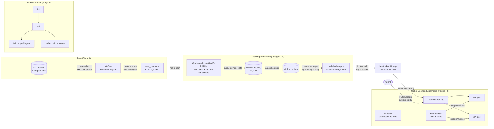

# Architecture

## How one prediction is traced

| Step | Where it is recorded |
|---|---|
| The response names the model | Body `model.version` / `model.run_id`, header `X-Model-Version` |
| The request is logged without clinical data | One JSON audit line per prediction: request id, model version, SHA-256 of the input, prediction, probability, imputed fields |
| The model version leads to its lineage | `GET /model-info` returns `models/champion/lineage.json` |
| Lineage leads to the training run | MLflow run id and parent run id, git commit, library versions |
| The run leads to the exact data | `data_sha256` of `heart_clean.csv` and the SHA-256 of `data/raw/MANIFEST.json` |
| The manifest leads to the source | URL, size and SHA-256 of every UCI file, retrieved at a recorded time |
| The deployment names its release | Image tag = commit; pod annotations and ConfigMap `heartrisk-release` carry commit, model version and run |

## Components

| Component | Technology | Why |
|---|---|---|
| Data validation gate | pandera schema built from `configs/data.yaml` | One definition of "plausible" shared by the gate, the clean-file check and the API |
| Model | scikit-learn pipeline (impute → scale / one-hot → model) | Preprocessing travels with the model, so there is nothing to re-implement at serving time |
| Experiment tracking and registry | MLflow 3.16 on SQLite | Parent / family / candidate run hierarchy; aliases instead of deprecated stages |
| Serialisation | skops (via MLflow's sklearn flavour) | Loading refuses types outside a pinned trust list; pickle would execute arbitrary code |
| API | FastAPI + uvicorn, one worker per pod | Typed contract with 422s, OpenAPI docs, Prometheus metrics |
| Container | Multi-stage Dockerfile, python 3.12 slim, uid 10001 | 162 MB pull, no compilers or wheels in the final image |
| Orchestration | Kustomize (base + release component + overlays) | No Helm needed; release values injected with `replacements` |
| Monitoring | Prometheus 3.15 + Grafana 13.2, own manifests | Scrapes annotated pods; alerts on input drift as well as outputs |
| CI | GitHub Actions | Lint, tests, reproducible data, training with a quality gate, container smoke test |
