# Heart-Disease Risk API: an end-to-end MLOps pipeline

**Machine Learning Operations (AIMLCZG523) · Assignment 1 · Rajesh Patel (BITS ID: to fill)**

**Repository:** https://github.com/2025AE05357-sys/heart-disease-mlops

> Educational project. The model is not a medical device and its output is not medical advice.

## 1. Introduction

The task was to build a classifier that predicts heart disease from routine clinical measurements
and to take it all the way to a monitored API on Kubernetes, using MLOps practice at every step:
reproducible data, tracked experiments, packaged models, CI, containers, deployment manifests and
monitoring.

I gave the project one organising principle, taken from my work on GxP-regulated clinical data
systems: **every prediction must be traceable.** For any answer the API gives, it must be possible
to say which model version produced it, which training run built that model, from which code
commit, and from which exact bytes of data. This principle decided many of the design choices
below, and each section points out where it shows up.

| Objective | Where it is met |
|---|---|
| Reproducible data with provenance | Section 3: checksum-pinned download, validation gate, data card |
| At least two tuned, cross-validated models | Section 4: logistic regression, random forest, gradient boosting |
| Every run tracked | Section 5: MLflow parent, family and candidate runs; registry aliases |
| A reusable, reproducible model artifact | Section 6: MLflow model in skops format with `lineage.json` |
| CI that fails loudly | Section 7: GitHub Actions with lint, tests, training and a quality gate |
| A containerised API | Section 8: FastAPI, non-root image, audit log |
| Deployment on Kubernetes | Section 9: kustomize manifests, LoadBalancer, self-healing |
| Monitoring | Section 10: Prometheus and Grafana, with a drift demonstration |

### Architecture

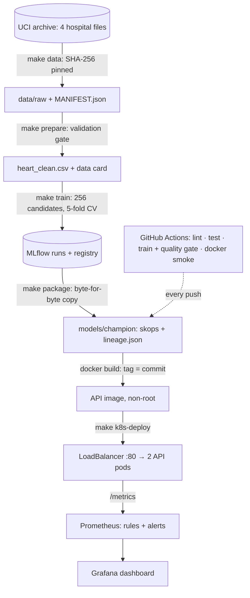

## 2. Setup and installation

| Item | Primary environment | Clean-machine alternative |
|---|---|---|
| Operating system | Windows 11 with WSL2 Ubuntu 24.04 | BITS lab VM (Rocky Linux 9.5) |
| Python | 3.12, one virtual environment, fully pinned lock file | same |
| Containers and cluster | Docker Desktop with its single-node Kubernetes (v1.36) | Docker Engine and minikube |
| Experiment store | MLflow on SQLite under `~/.heartrisk/mlflow` | same |

`scripts/vm_bootstrap.sh` sets up either environment idempotently: system packages, Docker access,
the Kubernetes context, and the virtual environment from `requirements.txt`. Dependencies are
declared in `requirements.in` and resolved with `uv` into a fully pinned `requirements.txt`; the API
image uses a second lock, `requirements-serve.txt`, compiled with the training lock as a constraint
so that scikit-learn, pandas, NumPy, SciPy and skops are identical at training and serving time.

Every stage is one `make` target:

```bash
make all                                   # verify data -> validation gate -> train -> package
make docker-build docker-run smoke         # the API in a container on :8000
make k8s-deploy k8s-smoke                  # the API on Kubernetes behind http://localhost
make monitoring-up traffic traffic-shift   # Prometheus :9090, Grafana :3000, drift demo
```

## 3. Data and exploratory analysis

### 3.1 Acquisition and provenance

The brief links to the UCI Heart Disease dataset, which is four hospital databases, not one file:
Cleveland (303 patients), Hungary (294), Switzerland (123) and VA Long Beach (200), each with the
same 14 attributes. `make data` downloads the four files and writes `data/raw/MANIFEST.json` with
the URL, size, SHA-256 and retrieval time of each, plus the licence (CC BY 4.0) and citation. Later
runs reuse local files that still match the manifest and refuse upstream bytes that differ from it,
so the training data cannot change without a visible diff. The raw files are committed.

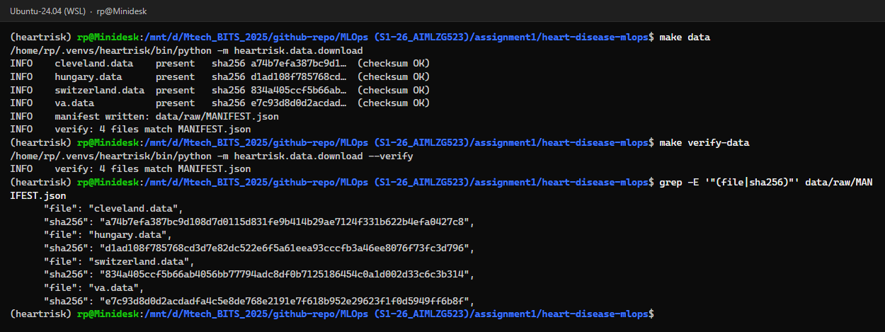

### 3.2 Validation gate and cleaning

`make prepare` runs a validation gate built with pandera from `configs/data.yaml`. It parses `?`
as missing, and it treats zeros in cholesterol and resting blood pressure as missing (decision D2):
no living patient has either value, and the Swiss file records every cholesterol as 0. Every row is
then checked against clinical plausibility ranges (for example cholesterol 80–700 mg/dl) and code
sets; a failing row goes to `rejected.csv` with its reason instead of being dropped silently, and a
site fails the run if its row count changes or more than 5% of its rows are rejected. All 920 real
rows pass. Imputation deliberately does not happen here: it belongs in the model pipeline, fitted on
training folds only. Each clean row keeps a `record_id` pointing to its line in the raw file, and the
generated data card records the SHA-256 of the output. Re-running the gate produces byte-identical
files, which CI checks on every push.

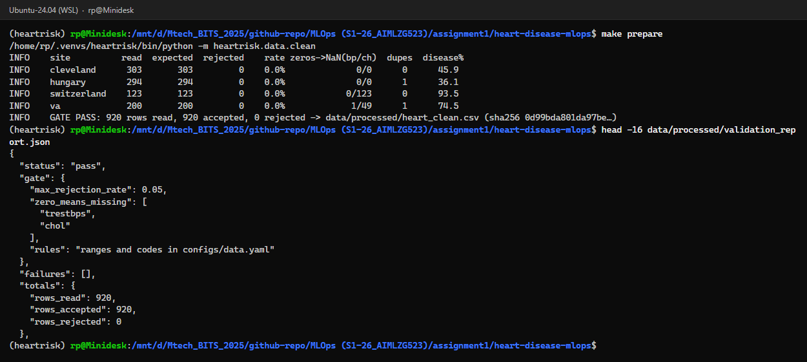

### 3.3 Exploratory analysis

The notebook `notebooks/01_eda.ipynb` (executed by `make eda`) compares the four sites and studies
Cleveland in depth. Figure 1 shows why decoding the zeros matters: Switzerland looks complete on
cholesterol until its zeros are read as "not measured".

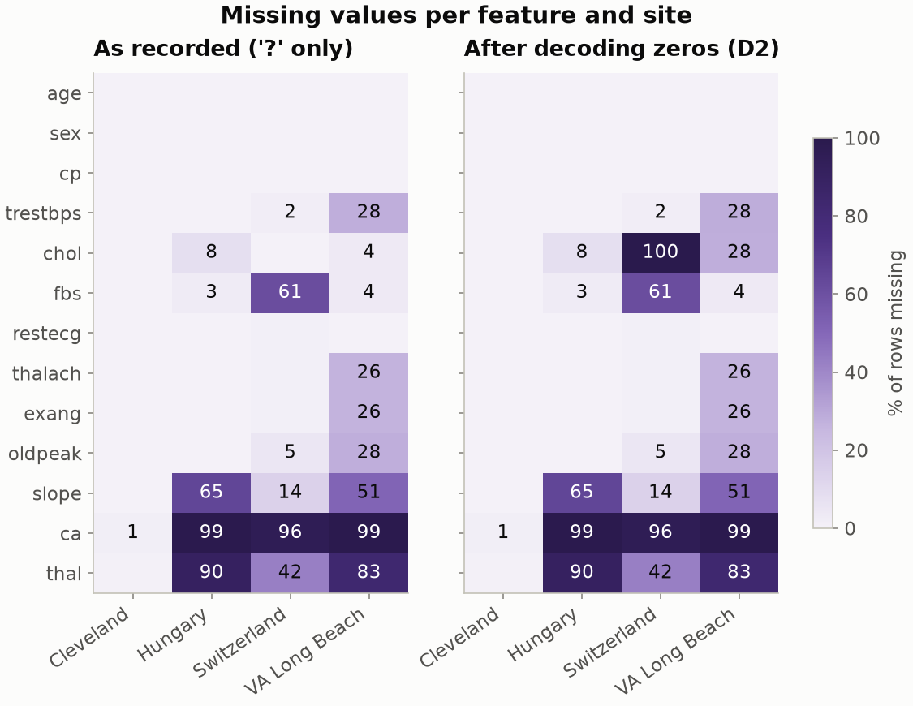

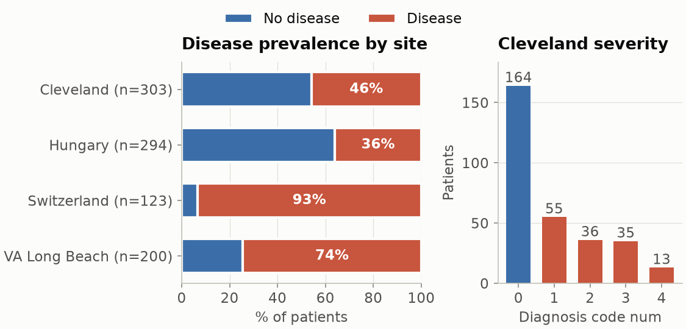

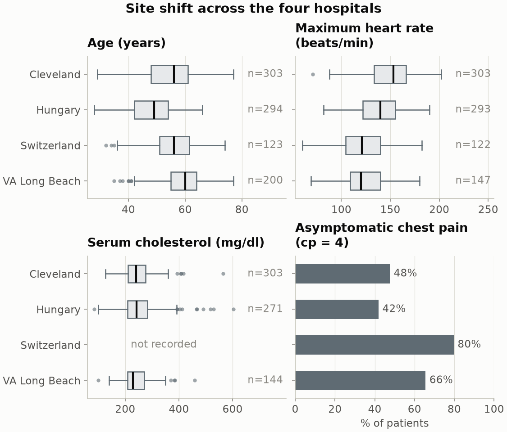

| # | Finding | Consequence for modelling |
|---|---|---|
| 1 | Cleveland is almost complete (2.0% of rows have a gap); at the other sites 99.5–100% of rows do, and `ca` is missing for 96–99% of patients | Train on Cleveland; impute inside the pipeline; expect weaker external results |
| 2 | Prevalence ranges from 36.1% (Hungary) to 93.5% (Switzerland), against 45.9% in Cleveland | Compare sites on ROC-AUC, which does not depend on prevalence |
| 3 | Strongest Cleveland signals: vessels on fluoroscopy (Spearman ρ = +0.49), exercise angina (+0.43), maximum heart rate (−0.42), ST depression (+0.41); cholesterol is weak (+0.12) | The clinically expected predictors dominate |
| 4 | External sites differ: median maximum heart rate 120–121 at Switzerland and VA vs 153 in Cleveland; asymptomatic chest pain 80% in Switzerland vs 48% | Built-in covariate shift, reused for the drift demonstration |
| 5 | Cleveland is close to balanced (164 without disease, 139 with) | No resampling; stratified cross-validation |

**Data scope (decision D1).** Pooling all 920 patients would triple the sample, but the site
predicts the label (Switzerland is 93.5% positive) and the missing-value pattern reveals the site,
so a pooled model could learn *which hospital* instead of physiology. I therefore train and tune on
Cleveland only and keep Hungary, Switzerland and VA Long Beach as external validation sets.

## 4. Features and model development

### 4.1 Pipeline

Every learned transformation lives inside one scikit-learn pipeline, so it is fitted on training
folds only and saved with the model:

| Step | Columns | Transformation |
|---|---|---|
| Engineered feature (D3) | age, maximum heart rate | Optional `hr_pct_pred`, tuned as a hyperparameter |
| Continuous | age, resting BP, cholesterol, max heart rate, ST depression | Median imputation, standardisation |
| Ordinal | vessels on fluoroscopy (`ca`) | Mode imputation, standardisation |
| Binary | sex, fasting blood sugar, exercise angina | Mode imputation |
| Nominal | chest pain, resting ECG, ST slope, thallium | Mode imputation, one-hot encoding that ignores unseen categories |

The engineered feature is the share of the age-predicted maximum heart rate that the patient
reached in the exercise test:

$$\mathrm{hr\_pct\_pred} = \frac{\text{thalach}}{220 - \text{age}}$$

**Notation:** $\text{thalach}$ = maximum heart rate reached (beats/min); $\text{age}$ = age (years);
$220 - \text{age}$ = conventional age-predicted maximum heart rate (beats/min); the result is
unitless (0.8 means 80% of the predicted maximum).

### 4.2 Models and tuning

Cleveland's 303 patients are split once, stratified and seeded, into 242 for training and
cross-validation and 61 for a locked hold-out set that no tuning step sees. Each model family (D4)
is tuned by grid search under stratified 5-fold cross-validation, scoring ROC-AUC, accuracy,
precision, recall and F1 and refitting on ROC-AUC: 256 candidates in total (logistic regression 32,
random forest 192, gradient boosting 32), 1,280 fits in about four minutes. scikit-learn 1.9
deprecates `LogisticRegression(penalty=…)`, so the L1/L2 choice is expressed as `l1_ratio ∈ {0, 1}`.

For a threshold of 0.5 on the predicted probability:

$$\text{Accuracy} = \frac{TP + TN}{TP + TN + FP + FN}, \quad \text{Precision} = \frac{TP}{TP + FP}, \quad \text{Recall} = \frac{TP}{TP + FN}, \quad \text{Specificity} = \frac{TN}{TN + FP}$$

**Notation:** $TP$ = patients with disease predicted as disease; $FN$ = patients with disease
predicted as healthy; $TN$ = healthy patients predicted as healthy; $FP$ = healthy patients
predicted as disease (all counts of patients).

$$F_1 = \frac{2 \cdot \text{Precision} \cdot \text{Recall}}{\text{Precision} + \text{Recall}}$$

**Notation:** $F_1$ = harmonic mean of precision and recall (unitless, 0 to 1).

$$\text{ROC-AUC} = \frac{1}{n_1 n_0} \sum_{i:\,y_i = 1} \; \sum_{j:\,y_j = 0} \mathbf{1}\left[p_i > p_j\right]$$

**Notation:** $n_1$, $n_0$ = numbers of patients with and without disease; $y_i$ = true class of
patient $i$; $p_i$ = predicted probability of disease for patient $i$; $\mathbf{1}[\cdot]$ = 1 when
the condition holds, else 0 (ties count ½). ROC-AUC is the probability that a random diseased
patient is ranked above a random healthy one: independent of the threshold and of prevalence.

### 4.3 Selection and results

The champion is chosen on cross-validation, never on the hold-out set (D5): the best mean CV ROC-AUC
wins, but families within 0.01 of the best are treated as tied, because such differences are inside
the fold-to-fold spread; among tied families the higher mean CV recall wins, because a missed
diagnosis costs more than a false alarm; a remaining tie goes to the simpler model.

| Model | CV ROC-AUC | CV recall | Hold-out ROC-AUC | Hold-out recall | Hungary | Switzerland | VA |
|---|---|---|---|---|---|---|---|
| **Logistic regression** | **0.909 ± 0.011** | **0.819** | 0.950 | 0.893 | **0.895** | 0.741 | 0.698 |
| Random forest | 0.904 ± 0.025 | 0.774 | 0.948 | 0.929 | 0.895 | 0.771 | 0.726 |
| Gradient boosting | 0.890 ± 0.020 | 0.792 | 0.951 | 0.893 | 0.841 | 0.739 | 0.705 |

Logistic regression (L1, C = 1, balanced classes) tied with random forest on ROC-AUC and won on
recall. The external columns vindicate the rule: gradient boosting had the best hold-out accuracy
(0.918) but collapsed at Hungary, where its recall fell to 0.13 against 0.62 for logistic regression.
Choosing on the 61-patient hold-out set would have picked the model that transfers worst.

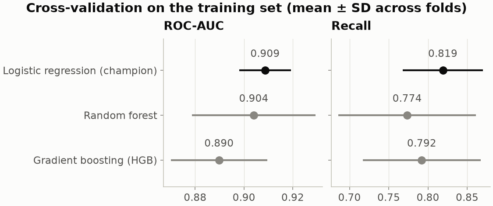

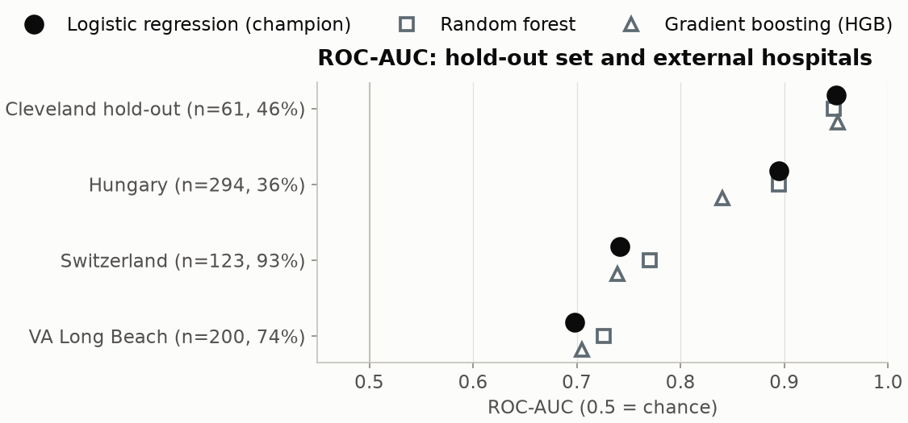

All three models lose discrimination at Switzerland and VA (ROC-AUC 0.70–0.77). These patients
are older, reach lower heart rates and lack the fluoroscopy and thallium tests that are the
strongest predictors in Cleveland. This is the central limitation of the model, and Section 10 turns
it into the monitoring design.

**Threshold (D6).** The class threshold stays at 0.5; on the hold-out set this gives recall 0.893,
and reaching 0.90 would need 0.475, a negligible change that would be fitted to 61 patients. The API
additionally returns a risk band (low below 0.3, high from 0.6) as a reading aid.

## 5. Experiment tracking

MLflow records every run in a three-level hierarchy: one parent run per `make train`, one child
run per model family, and one nested run per hyperparameter candidate (256 per training).

| Level | Logged |
|---|---|
| Parent | Lineage tags (git commit, uncommitted-changes flag, SHA-256 of the clean data and of the raw manifest, library versions); the training dataset with its digest; the config; comparison figures; reports |
| Family | Best parameters; mean and SD of every CV metric; hold-out and external metrics; ROC, confusion, calibration and importance plots; the full CV table; the fitted pipeline as an MLflow model |
| Candidate | Parameters; mean and SD of every CV metric; rank |

The champion and the runner-up are registered as `heart-disease-classifier` under the aliases
`champion` and `challenger` (stages are deprecated in MLflow 3), with the selection reason, data
hash and commit as version tags. `make experiments-report` exports the family runs to
`reports/experiments.csv`.

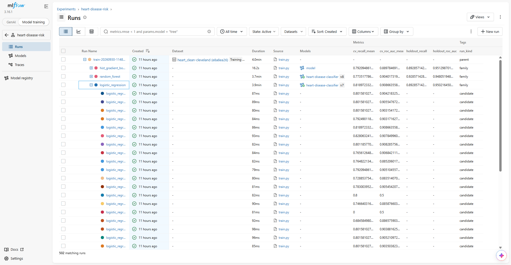

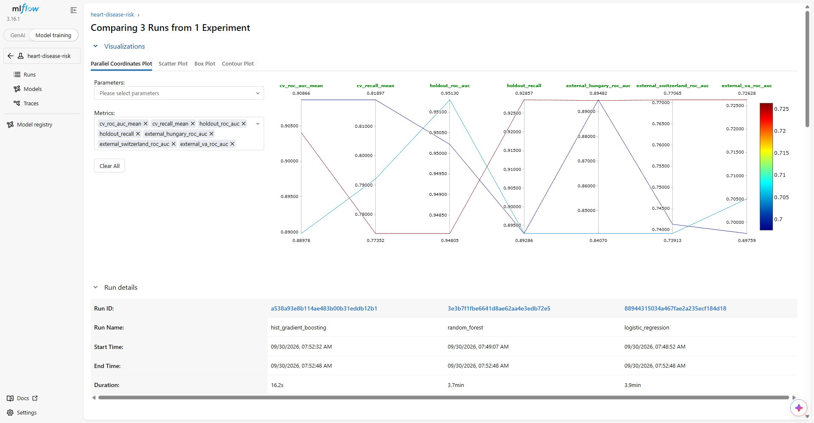

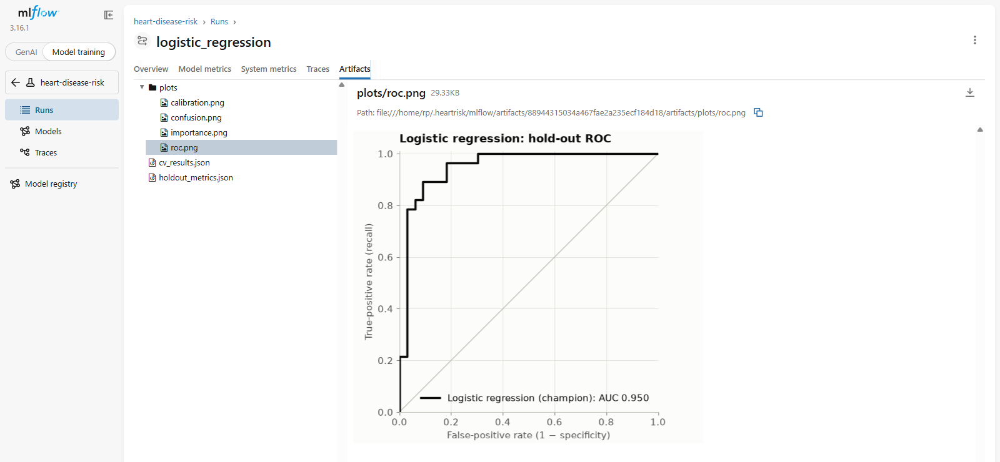

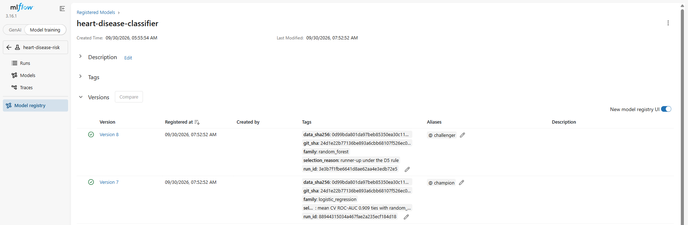

## 6. Packaging and reproducibility

`make package` copies the registered champion **byte for byte** into `models/champion/`: an MLflow
model directory with the pipeline serialised by skops, its signature, an input example and pinned
requirements. skops was chosen over pickle (D7) because loading a pickle can execute arbitrary code
from the file, whereas skops only reconstructs types on a trust list. That list is pinned in code;
the loader refuses a model whose own declared list goes beyond it, which a test demonstrates.

Before writing anything, packaging verifies two facts and fails otherwise: the clean data still
has the hash recorded at training, and the exported file reproduces the hold-out ROC-AUC logged at
training time (0.95021645 in both cases for the current model). `lineage.json` then records the
registry version, runs, commit, data hashes, rows per split and site, library versions and all
metrics, including a slice by sex; `docs/MODEL_CARD.md` is generated from it. The model folder is
committed (D8), so the container build needs neither retraining nor access to a registry.

Reproducibility is tested at three levels: retraining with the same seed reproduces the comparison
table exactly; re-running the data gate reproduces the clean files byte for byte; and the exported
model gives predictions identical to the registry copy.

## 7. CI/CD and automated tests

The test suite has 104 tests with 95% line coverage and no network access: hand-written raw rows in
each site's format for the data gate, hand-worked metric examples, a real 121-row sample for fast
end-to-end training, packaging and API tests, and security tests for the model loader.

| Job | Steps | Evidence produced |
|---|---|---|
| `lint` | ruff check and format check at the locked version | Annotations on the pull request |
| `test` | pytest with coverage | JUnit and coverage XML (uploaded even on failure), coverage table in the job summary |
| `train` | Verify raw data against the manifest; re-run the validation gate and **fail if a single byte of `data/processed` differs from git**; train; package; quality gate (D9: hold-out ROC-AUC ≥ 0.80) | Reports, model, model card and MLflow store as artifacts; metrics table in the job summary |
| `docker` | Build the image tagged with the commit, run it, smoke-test it | Image size, container logs |

Each job has a timeout, runs bash with `-euo pipefail`, and uses the current major versions of the
official actions; the workflow passes actionlint. The first run on `main` shows a failure being
caught: the quality-gate step invoked the gate module without the package on its import path, so the
job stopped with a clear `ModuleNotFoundError` in the log. Running the gate through `make` fixed it
(commit `60f4cd9`), and the following runs were green.

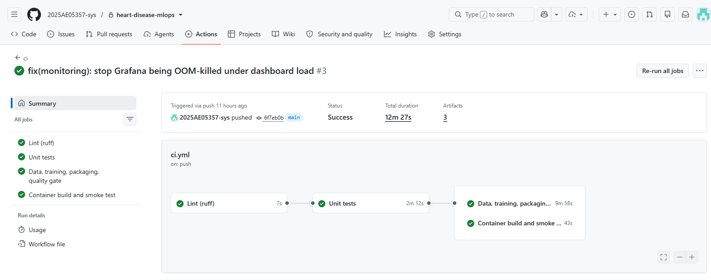

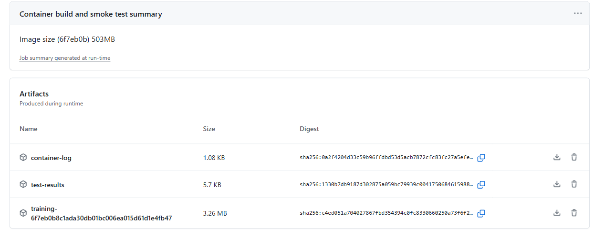

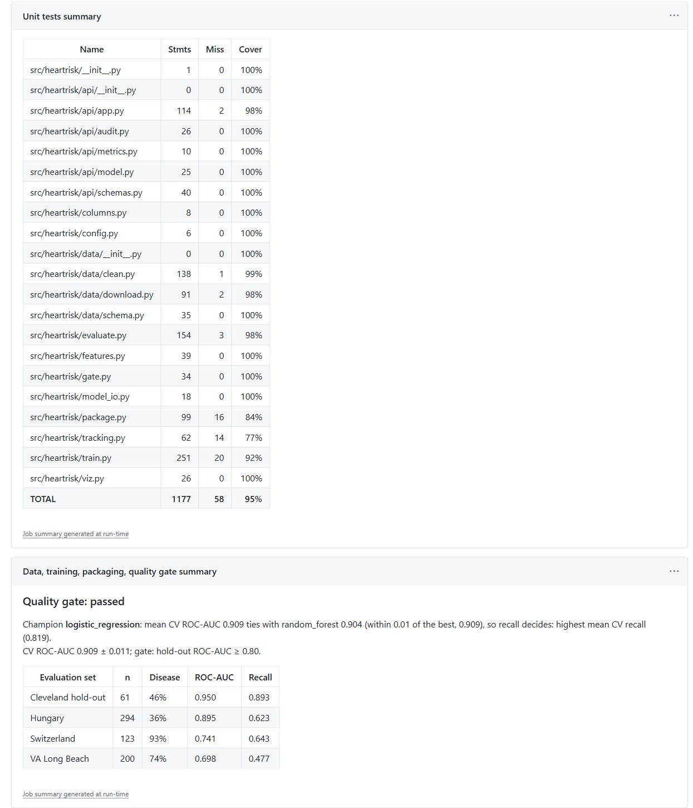

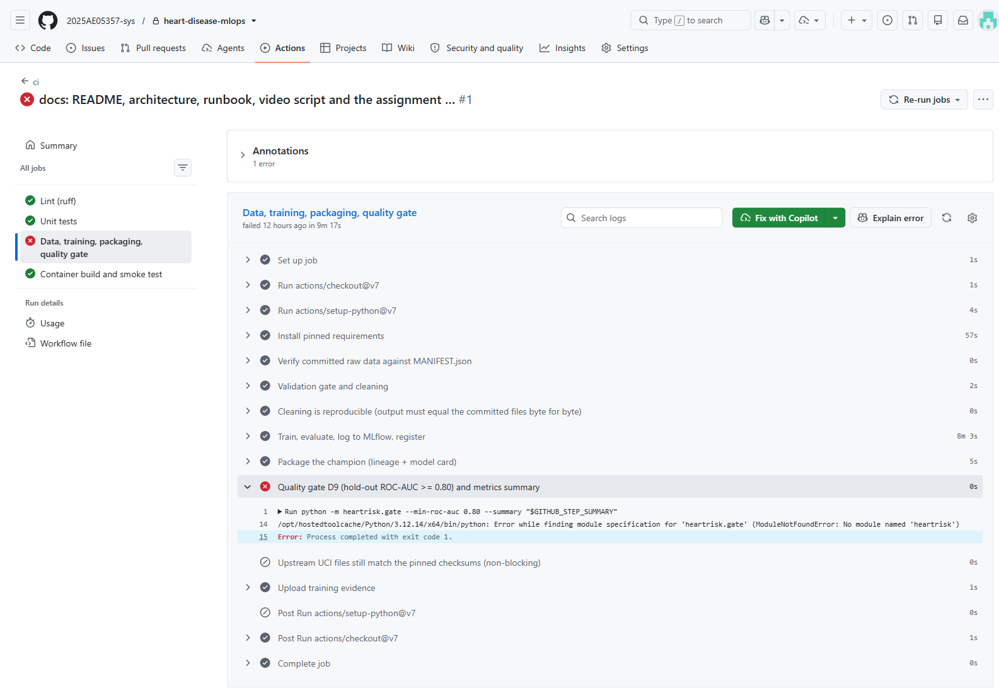

## 8. Serving and containerisation

The API (FastAPI) loads the model once at start-up and exposes:

| Endpoint | Purpose |
|---|---|
| `POST /predict`, `POST /predict/batch` | Class, probability, confidence, risk band, imputed fields and the model's identity (batch: up to 100 patients) |
| `GET /model-info` | The model's `lineage.json` |
| `GET /health`, `GET /ready` | Liveness; readiness returns 503 until a model is loaded |
| `GET /metrics`, `GET /docs` | Prometheus series; interactive documentation |

The input contract mirrors the data gate exactly (a test enforces it). Only age, sex and chest-pain
type are required, because they are recorded at every site; any other value may be null, and the
response lists it under `imputed_fields`, so the caller knows when an answer rests on estimates.
Every response carries `X-Request-ID` (propagated or generated) and `X-Model-Version`. Every
prediction writes one JSON audit line with the request id, model version, prediction and the
SHA-256 of the canonical input, but not the clinical values themselves, so the log can prove which
input produced which answer without holding patient data.

The image is multi-stage: wheels are built in a first stage and bind-mounted, not copied, into the
runtime stage, which cut the download from 245 MB to 162 MB. It runs as a non-root user (uid 10001),
has a health check, and carries the commit and model version as OCI labels; a `.dockerignore`
allow-list sends only the serving lock, the package and the model to the build.

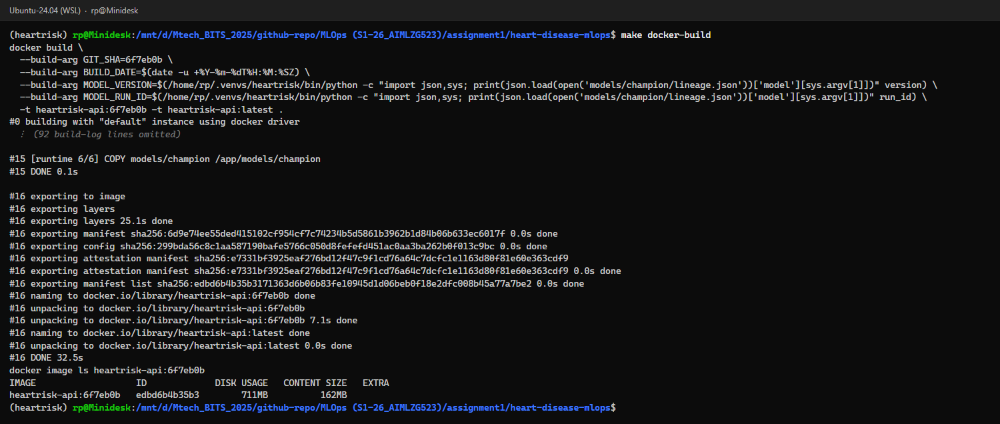

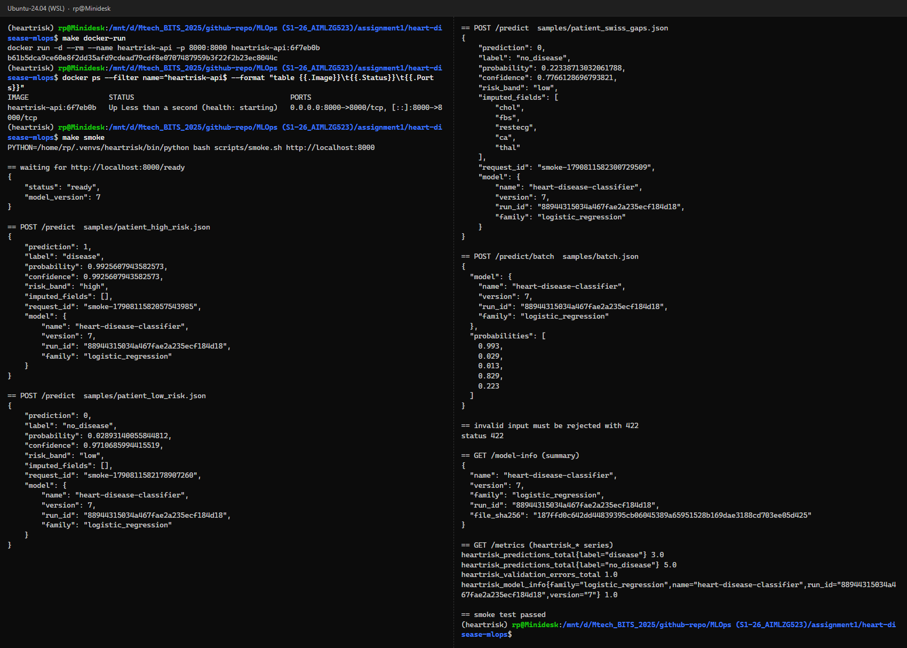

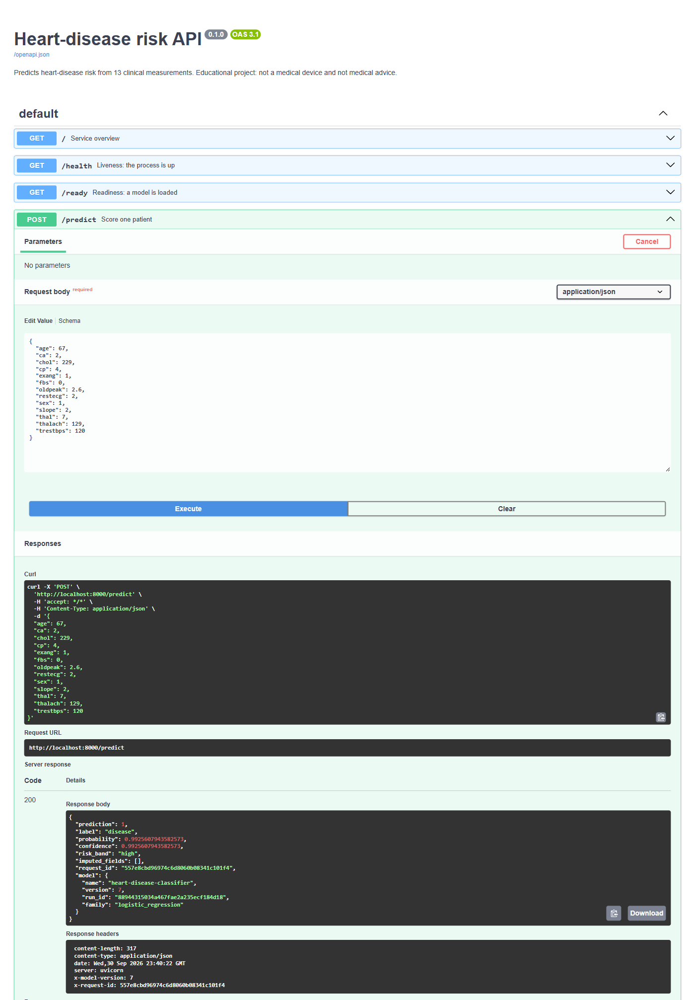

## 9. Deployment on Kubernetes

The manifests use kustomize: a base, a release component and two overlays.

| Object | Key settings |
|---|---|
| Namespace | Enforces the **restricted** Pod Security Standard, so Kubernetes itself rejects any pod that runs as root, keeps capabilities or can escalate privileges |
| Deployment | 2 replicas; rolling updates with `maxUnavailable: 0`; CPU and memory requests and limits; read-only root filesystem; no service-account token; Prometheus annotations |
| Probes | Startup and liveness on `/health`, readiness on `/ready`: a pod whose model fails to load stays out of the Service instead of crash-looping |
| Service | LoadBalancer on port 80 (Docker Desktop publishes it on localhost) |
| PodDisruptionBudget | At least one pod stays available during voluntary disruptions |
| Release component | `make k8s-release` writes image tag, commit, model version and run id; kustomize `replacements` stamp them onto the pod template and keep them in ConfigMap `heartrisk-release` |

The brief allows a load balancer or an ingress (D11). The LoadBalancer overlay is deployed; an
ingress overlay for Traefik at `heartrisk.localtest.me` passes a server-side dry run and is ready
for when an ingress controller is installed. Deleting a pod demonstrates self-healing: the
Deployment had a replacement pod Ready within about 20 seconds while the other pod kept serving.

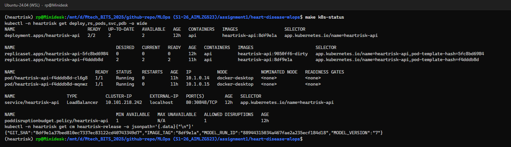

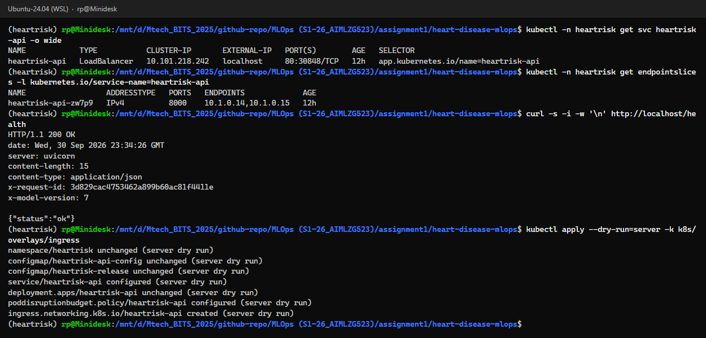

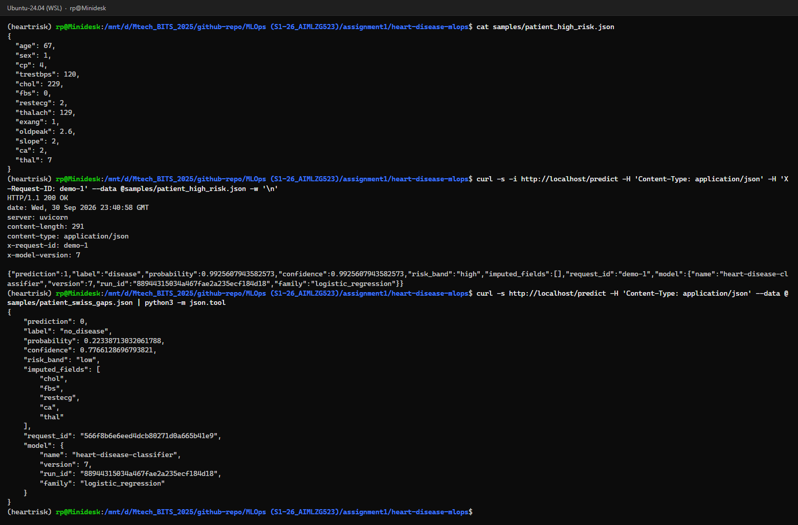

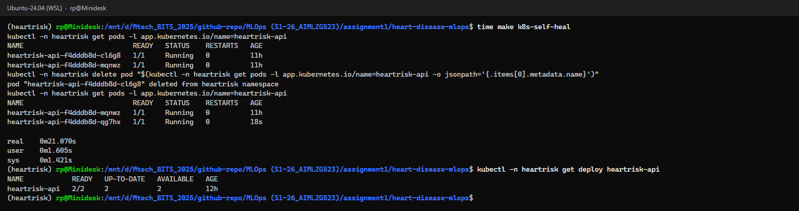

## 10. Monitoring and logging

Prometheus discovers the annotated API pods through a read-only role, scrapes them every 5 seconds
and labels each series with the pod and the model version. The API exposes request counts and
latency, predictions by label, the probability distribution, the distributions of age, cholesterol
and maximum heart rate, imputed inputs per field, validation errors and the model's identity.
Grafana is provisioned entirely from code, with its data source, a dashboard and an admin password
from a Secret created at deploy time. Both run under the same restricted Pod Security Standard.

The external validation in Section 4 predicted how this model fails: on patients from another
hospital. `scripts/traffic.py` replays real patients as traffic, from Cleveland in normal mode and
from Switzerland and VA in shift mode, and the results confirmed the prediction:

| Signal | Cleveland traffic | Swiss + VA traffic |
|---|---|---|
| Mean maximum heart rate | ≈ 151 beats/min (training mean 149.6) | ≈ 120 beats/min |
| Mean age | ≈ 54 years (training mean 54.4) | ≈ 58 years |
| Imputed inputs per prediction | ≈ 0 | ≈ 3 |
| Predicted positive rate | ≈ 44% | ≈ 47%, although 82% of these patients have disease |
| Alerts | none | `HeartriskInputDrift` and `HeartriskHighImputation` firing |

The last two rows are the most important result of the project. Under drift the model silently
under-calls disease, and its output distribution barely moves, so an alert on the predicted
positive rate alone stayed quiet. The alerts that fired watch the **inputs**: mean maximum heart rate
more than 15 beats/min away from the training mean, and more than one imputed input per prediction.
Logs are JSON lines on stdout (access and audit), read with `make k8s-logs`.

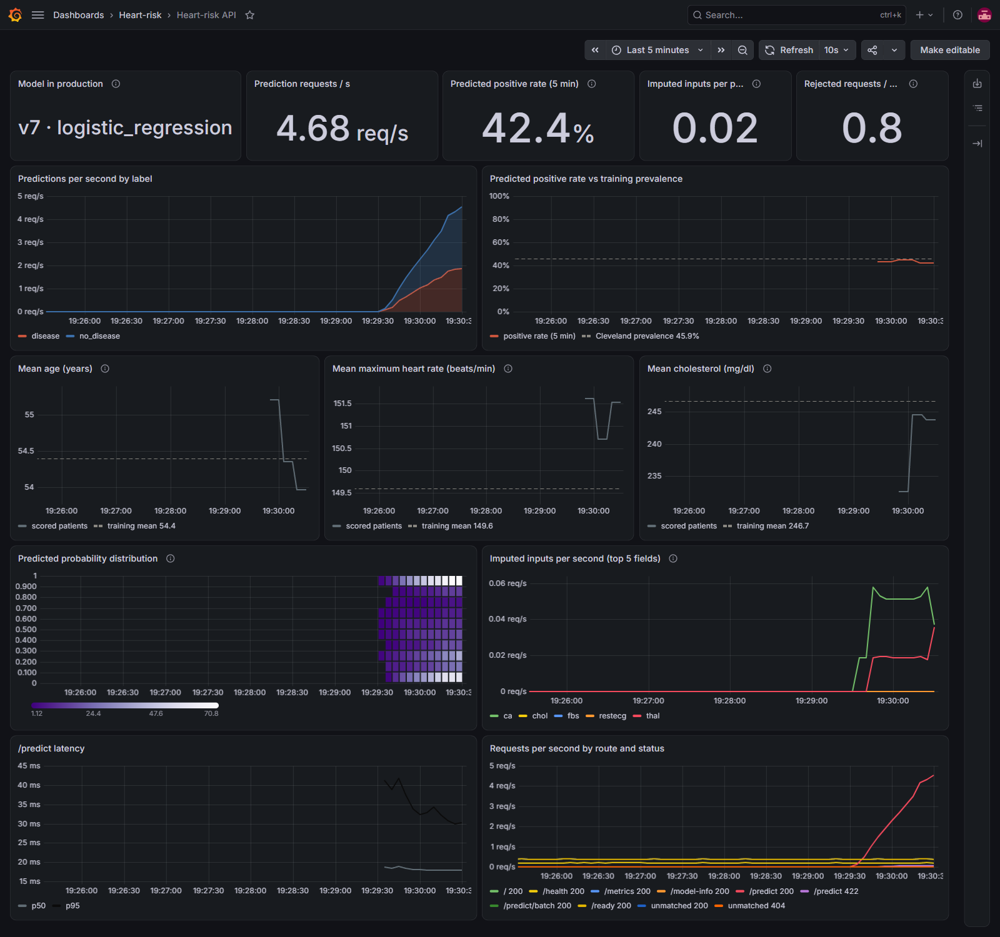

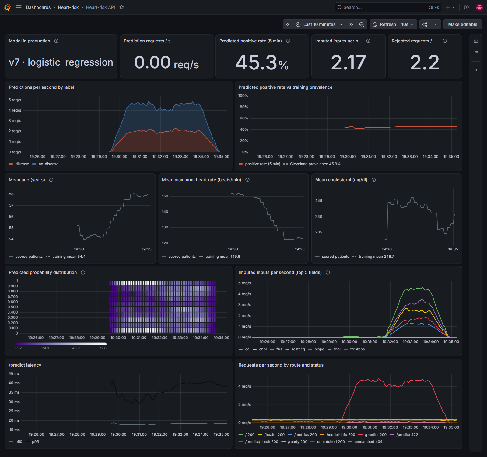

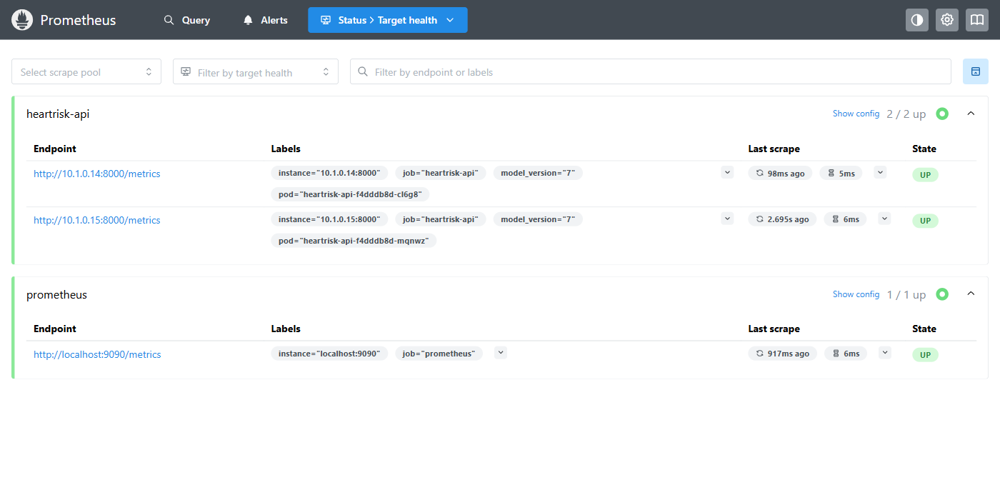

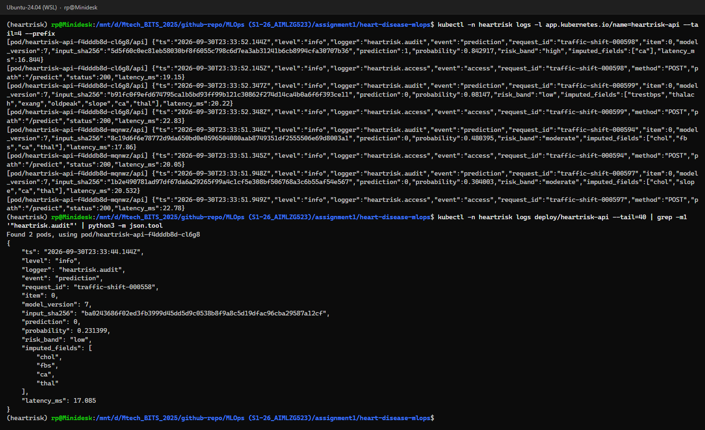

## 11. Results, limitations and future work

The champion reaches a cross-validated ROC-AUC of 0.909 and 0.950 on the hold-out set, but 0.70–0.74
at the VA and Swiss hospitals. The data explain why: those patients are older, reach lower heart
rates and mostly lack the two strongest tests. The model card lists the limitations in full.

| Limitation | Future work |
|---|---|
| 242 training patients from the 1980s | Retrain on a larger, contemporary cohort; report confidence intervals |
| Poor transfer to other hospitals | Recalibrate per site, or train with site-aware methods once labelled local data exist |
| Probabilities calibrated to Cleveland's prevalence | Per-site recalibration; monitor calibration once outcomes arrive |
| Sex carries a large weight (cohort effect) | Fairness evaluation on larger slices |
| Drift is detected, not acted on | Route a retraining pipeline from the drift alert, with the challenger as a shadow model |

## 12. Conclusion

The pipeline goes from four checksum-pinned public files to a monitored API on Kubernetes, and
every link in between is recorded: a prediction names its model version, the model's lineage names
its training run, commit and data hashes, and the deployment names its release. Traceability
shaped the design choices, and it paid off in the monitoring stage, where tracing performance back to
the data made the model's real weakness visible and turned it into an alert that fires.

Repository: https://github.com/2025AE05357-sys/heart-disease-mlops · Data: Janosi, Steinbrunn,
Pfisterer & Detrano (1989), UCI Machine Learning Repository, https://doi.org/10.24432/C52P4X (CC BY 4.0).
